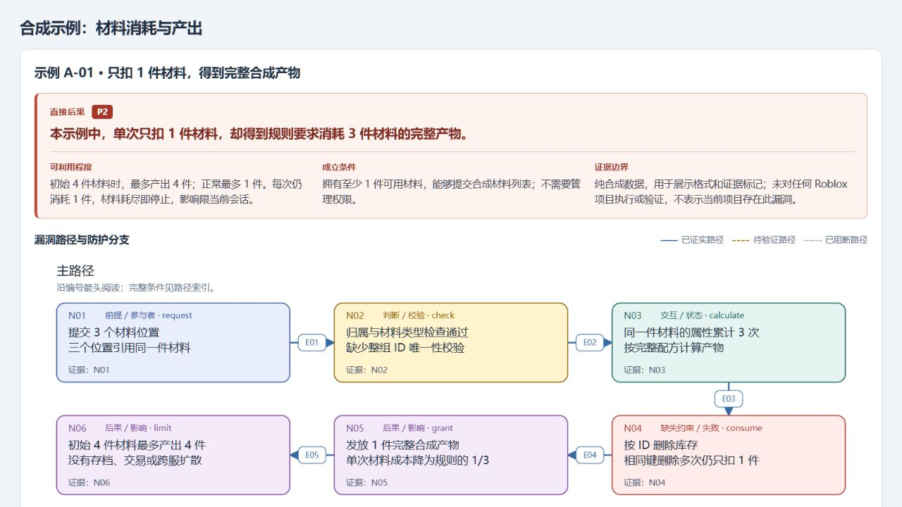
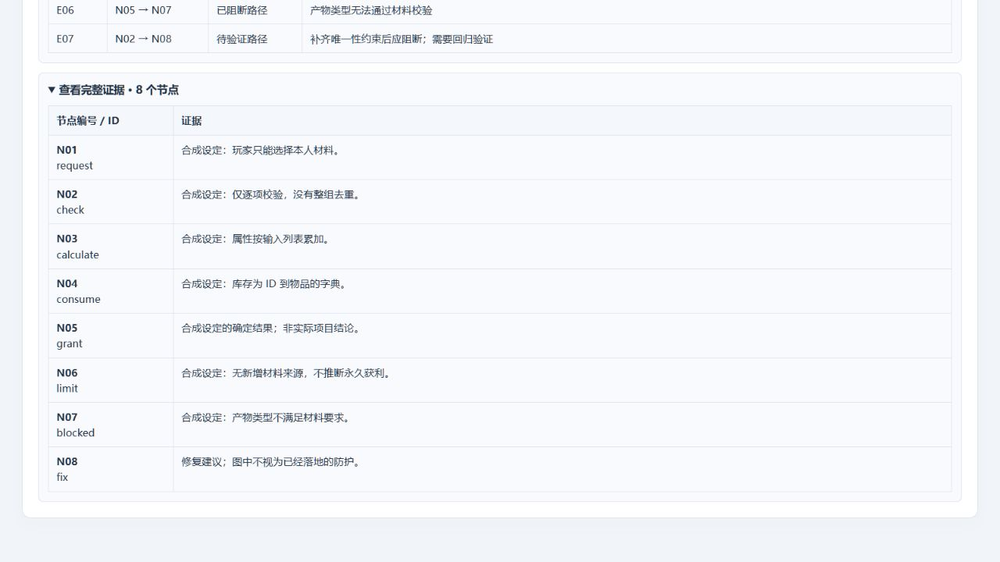

# Blox Security Audit

**让 AI agent 帮你检查 Roblox 源码，把漏洞、证据和修复方向讲清楚。**

从本地项目或 Studio 源码出发，追踪客户端输入、服务端校验、资产变更和存档恢复。每条发现都说明：谁能触发、会造成什么后果、依据在哪里，以及哪些影响还没有验证。

| 你需要什么 | 选择 |
| --- | --- |
| 完整审计，面向开发者阅读的报告与流程图 | [blox-security-audit](skills/blox-security-audit/SKILL.md) |
| 只要文本，交给 agent 修复或直接要求自动修复 | [bsa-lite](skills/bsa-lite/SKILL.md)，可独立安装 |

[](https://github.com/Xorice/bsa/actions/workflows/validate.yml)
[](LICENSE)
[](skills/blox-security-audit/SKILL.md)

[快速开始](#快速开始) · [效果预览](#效果预览) · [检查什么](#检查什么) · [常见问题](#常见问题) · [开发与贡献](#开发与贡献)

## 快速开始

### 1. 安装 skill

准备好 Node.js 22.20 或更新版本与 npm，在终端运行：

```sh
npx skills add Xorice/bsa --skill blox-security-audit --global
```

跟随提示选择你使用的 agent。`--global` 表示用户级安装，可在不同项目中使用；共用 skill 目录为 `~/.agents/skills/blox-security-audit`，各 agent 的发现路径由安装器处理。可选 agent 与具体安装方式见 [Skills CLI 文档](https://github.com/vercel-labs/skills)。

只需要文本审计与修复，安装轻量版：

```sh
npx skills add Xorice/bsa --skill bsa-lite --global
```

两种 skill 可以同时安装；`bsa-lite` 使用 `~/.agents/skills/bsa-lite`，不需要另装完整版。

<details>
<summary>指定 agent、项目级安装与更新</summary>

只安装给 Codex，并跳过交互选择：

```sh
npx skills add Xorice/bsa --skill blox-security-audit --global --agent codex --yes
```

只在当前项目使用：在项目目录运行，省略 `--global`。

```sh
npx skills add Xorice/bsa --skill blox-security-audit
```

更新已安装的用户级版本：

```sh
npx skills update blox-security-audit --global
```

也可以手动复制仓库内的 `skills/blox-security-audit/` 到 agent 的 skill 目录；保留其中的文件与相对位置。不同 agent 加载新 skill 的方式不同，安装后按所用工具的提示重新加载。

</details>

### 2. 让 agent 能读到项目

| 你的项目在哪里 | 开始前准备 |
| --- | --- |
| 本地 Luau、Roblox-TS 或 Rojo 工程 | 在 agent 中打开项目，或提供源码目录及项目映射。 |
| Roblox Studio | 连接能读取 Studio 源码的工具，并明确要检查的 Place。skill 会核对目标和编辑/运行上下文。 |
| 导出源码或代码片段 | 提供文件与调用上下文；结论会限定在实际可见的范围。 |

skill 使用 agent 已有的文件、搜索和 Studio 能力。安装 skill 后，Studio 的工具连接仍需单独配置；本地源码审计无需 Studio。

### 3. 发起第一次审计

在支持 skill 调用的 agent 中输入：

```text
$blox-security-audit

审计当前 Roblox 项目，重点检查交易、奖励、付费收据和存档恢复。
默认只读源码。输出漏洞证据、影响边界、修复建议和流程图，
同时列出已检查的防护与未覆盖范围。
```

也可以直接说「用 blox-security-audit 审计这个项目」。首次使用建议说明重点系统；已有报告时，可要求逐项复核，区分仍成立、已修复、被反证和未完成的项目。

### 只要文本，或让 agent 自动修复

用轻量版直接审计并修复当前项目：

```text
$bsa-lite

检查当前 Roblox 项目的交易和存档链，修复已确认的漏洞。
只输出文本，给出源码位置、潜在恶意利用、实际修改和回归结果。
```

也可以说「用 bsa-lite 按这份 report.md 修复漏洞」。agent 会先对照当前代码逐项复核，再实施有证据的最小修复、检查合法功能和失败恢复，并说明哪些已验证、哪些仍有缺口。只要求审计或提供发现时保持只读；明确要求修复时才改业务。轻量版不生成流程图、HTML 或图数据，默认直接回复文本；需要落盘时可指定 Markdown 文件。

## 效果预览

以下是仓库内[合成示例](skills/blox-security-audit/examples/flows.json)实际渲染的页面截图，用于展示输出格式，不对应任何真实游戏的审计结论。

### 先看清后果，再读漏洞路径

页面先展示直接后果、可利用程度、成立条件和证据边界，再按编号展开触发过程。已证实、待验证和已阻断的路径分别标记。



### 需要复核时，展开证据

路径条件和节点证据保留在可展开的表格中。实际审计时，证据对应源码位置、版本或验证结果，便于开发者复查。



### 最终拿到什么

默认输出到项目约定的目录；没有约定时使用 `docs/security-audit/<日期或审计id>/`。常见产物包括：

| 产物 | 用来做什么 |
| --- | --- |
| `report.md` | 查看发现、严重度、证据、修复建议和回归用例，也保留覆盖账本与盲区。 |
| `flows.html` | 在浏览器中离线阅读漏洞路径与影响摘要。 |
| `flows.json` | 保留图的节点、关系和证据标记，便于再次生成。 |
| SVG / Mermaid | 将图嵌入开发文档、问题单或复盘材料。 |

没有确认漏洞时，也会说明查过哪些路径、哪些防护起效、还有哪些未知。已有报告中的条目会留下本轮去向，不因本轮未列出就默认已修复。

报告也会提醒有依据的潜在恶意利用。例如保存失败不仅可能丢进度：若资产仍可转出、接收方保存成功而本方恢复旧快照，就可能形成资产复制。尚未追完的条件会标为待验证，并列出补证任务；不会因为缺少最终复现就省略提醒，也不会把猜测写成已确认利用。轻量版保留相同的证据要求。

## 检查什么

| 范围 | 重点问题 |
| --- | --- |
| 交互与权限 | 请求者是否有权限操作该玩家、物品或对局；服务端是否重新检查身份、归属和阶段。 |
| 经济与资产 | 材料能否重复引用；价格和数量是否可信；交易、摆摊、合成与物品锁是否保持一致。 |
| 存档与奖励 | 收据确认、领取标记与奖励是否一起持久化；保存失败或重投后能否恢复。 |
| 异步与生命周期 | 等待后的旧任务是否误操作新会话；取消、离服、销毁和失败分支是否留下副作用。 |
| 依赖与资源成本 | 网络及存档库实际保证了什么；请求能否持续增长队列、缓存、实例或外部读取量。 |

审计从实际入口与危险效果双向追踪，检查校验成功和失败后的行为；有独立范围和委派能力时可并行深查，没有时串行完成。覆盖记录细化到相关生命周期，而不是读过一个模块就视为全部安全。

## 常见问题

### 需要运行游戏吗？

默认只读源码，允许生成本地审计报告。需要验证时优先使用纯函数、提取代码和内存模型；不会因为安装了 skill 就自动执行真实支付、修改存档或进行压力测试。运行边界见[验证约定](skills/blox-security-audit/references/validation.md)。

### 支持哪些 agent？

能加载本地 `SKILL.md` 并读取项目的 agent 都可按指引工作。安装器支持的工具见 [Skills CLI](https://github.com/vercel-labs/skills)；本 skill 不绑定特定 MCP 或开发框架。直接使用仓库时，入口是 [SKILL.md](skills/blox-security-audit/SKILL.md)。

### 会自动修复漏洞吗？

完整版审计默认不改业务源码。需要自动修复时，使用 `bsa-lite` 并明确要求修复；它也可接收已有报告，复核当前版本后修改并验证。仅安装或调用 skill 不会自动发布、更改线上玩家存档或执行真实支付。

### 能保证找出所有漏洞吗？

不能。结果取决于可见源码、版本、配置、工具能力和实际覆盖范围。源码推导、模型结果与真实运行证据会分别记录；无法确认的影响保留为待验证风险。报告和图用于辅助开发者审查，不代替发布版本核对与运行验证。

## 开发与贡献

欢迎通过 [Issue](https://github.com/Xorice/bsa/issues) 提交问题或建议，或阅读 [CONTRIBUTING.md](CONTRIBUTING.md) 参与改进。复现材料请使用合成数据，避免提交私有游戏源码、真实账号和密钥。

<details>
<summary>本地检查与示例截图复现</summary>

仓库工具使用 Python 3.10 或更新版本的标准库，不需要安装额外 Python 包。以下命令均在仓库根目录执行；按环境将 `python` 改为 `python3` 或 `py -3`。

```sh
python -B scripts/check_repo.py
python -B -m unittest discover -s tests -v
```

生成截图所用的同一份示例页面：

```sh
python -B skills/blox-security-audit/scripts/render_flow.py --input skills/blox-security-audit/examples/flows.json --output out/flows.html --svg-dir out/svg --mermaid-dir out/mermaid
```

在浏览器打开 `out/flows.html`，查看摘要与流程图，展开「完整路径条件」和「完整证据」即可复现截图内容。页面不依赖 JavaScript、CDN 或远程字体。

渲染器负责校验图数据并生成 HTML、SVG 和 Mermaid，不分析源码或判断证据真假。完整输入格式见[流程图约定](skills/blox-security-audit/references/diagrams.md)。命令会覆盖指定输出，生成文件保留在已忽略的 `out/` 中。

仓库检查验证文件结构、元数据、本地链接、Python 语法与示例输入；测试覆盖导出、分支、转义、输入保护及独立复制后的运行。它们验证工具行为，不等同于审计能力评估。GitHub Actions 运行相同检查。

</details>

<details>
<summary>仓库结构与审计指引</summary>

```text
skills/blox-security-audit/
├── SKILL.md             # agent 的审计入口
├── agents/              # 界面元数据
├── references/          # 覆盖、推理、验证、报告与流程图约定
├── scripts/             # 离线流程图渲染器
├── examples/            # 可复现的合成示例
└── LICENSE

skills/bsa-lite/
├── SKILL.md             # 独立的文本审计、修复与验证指引
├── agents/              # 界面元数据
└── LICENSE

assets/readme/           # 本 README 的页面截图
scripts/                 # 仓库检查
tests/                   # 工具测试
```

- [定位与覆盖](skills/blox-security-audit/references/discovery.md)
- [推理与反证](skills/blox-security-audit/references/reasoning.md)
- [潜在恶意利用与证据边界](skills/blox-security-audit/references/abuse-analysis.md)
- [持久化与资产一致性](skills/blox-security-audit/references/persistence.md)
- [验证边界](skills/blox-security-audit/references/validation.md)
- [报告格式](skills/blox-security-audit/references/reporting.md)

</details>

## 许可

[MIT](LICENSE)。独立复制或分发任一 skill 时，请保留各自目录内的许可证。
